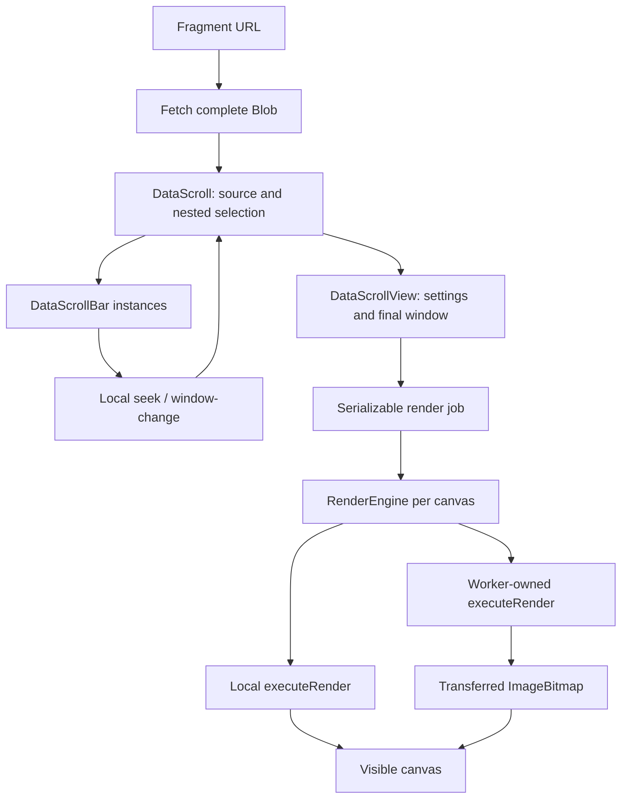

# Architecture

## Ownership before abstractions

The central input is an immutable `Blob`. Its `.size`, `.slice()` and
`.arrayBuffer()` supply the random-access behavior the application needs. A
separate ByteSource wrapper was removed because it duplicated those primitives.
The initial stream/buffer/map/view vocabulary in the root README is a broader
vision; the current implementation does not expose that generic streaming API.

`DataScroll` owns the root Blob and selected byte ranges. Views and bars receive
snapshots; they send navigation intents back to their owner rather than quietly
changing offsets during rendering. This prevents several UI controls from each
maintaining a different interpretation of the same selection.



## Elements and event boundaries

| Class / tag                           | Responsibility                                                   | Important boundary                                                                  |
| ------------------------------------- | ---------------------------------------------------------------- | ----------------------------------------------------------------------------------- |
| `Popup` / `ui-popup`                  | Native popover positioning and dismissal.                        | Coordinates are viewport pixels.                                                    |
| `ContextMenu` / `context-menu`        | Descriptor-driven nested menus and focus.                        | Submenus are DOM descendants so native auto-popovers keep their ancestors open.     |
| `ByteCanvas`                          | Internal canvas, resize observer, renderer lifetime.             | Removing an element cancels its worker and pending work.                            |
| `DataScrollView` / `data-scroll-view` | Visualization settings, geometry, rotation, final source window. | `offset` is absolute within the root Blob.                                          |
| `DataScrollBar` / `data-scroll-bar`   | Parent-scope overview and child selector.                        | Cursor offsets are local to that parent scope.                                      |
| `DataScroll` / `data-scroll`          | Source, scope reconciliation, menu composition.                  | The only component that translates all nested scopes into the final absolute range. |

View/bar `seek` events and bar `window-change` events are listened to directly by
`DataScroll`; they are not a public, bubbling global event bus. `window-change`
includes `{offset, length, edge}`. A view `layout-change` requests selection reconciliation before rendering; an
explicit configuration change includes the committed length so arrangement/stride
edits preserve the selected byte interval. Rendering errors use a bubbling, composed
`data-error` event so they can cross shadow roots. Fetch errors currently go to
`console.error` in the bootstrap loader.

## Entry point and source loading

`index.html` imports `bootstrap.js`, which imports the components, mounts a
full-screen `DataScroll`, and installs the fragment loader. A new fragment aborts
the previous fetch; a failed replacement leaves the previous Blob visible.

Importing `main.js` registers components and never mounts the demo, regardless of
DOMContentLoaded timing. The bootstrap handles both early and late imports.
Pure recipe/rendering modules can be imported without a DOM; importing `main.js`
in tests still requires DOM stubs.

A minimal programmatic instance is:

```js
const { DataScroll } = await import("./main.js");
const response = await fetch("./examples/cat");
if (!response.ok) throw new Error(`HTTP ${response.status}`);
const scroll = new DataScroll(await response.blob(), 4096);
document.body.append(scroll);
scroll.barCount = 2;
scroll.seek(1024); // absolute root-source byte offset
```

`DataScroll` also wraps non-Blob input in `new Blob([source])`. Reusable presets
persist in localStorage; source bytes do not. There is no file picker, server API,
or live stream transport.

## Settings: profiles, compatibility, and raw configuration

Every view uses one point pipeline. Presets supply configuration and appearance
rather than selecting renderers. Reading `view.pointConfiguration` resolves those
defaults lazily; assigning it changes the same data consumed by the shared pipeline.
Strings, expressions, text overlays and custom spaces do not trigger promotion or
switch factor layouts. Byte, tuple and bin populations retain their sampling
contracts across edits. See [selection semantics](data-selection.md#point-populations-and-mixed-analyses).

Legacy jobs/profiles without configuration are normalized before rendering.
Coordinate-system and axis-permutation choices become ordinary space/position
settings. Explicit configuration remains authoritative.

`applyPreset(name)` resets appearance overrides, legacy coordinates/axes, shader
flags, camera orientation, and raw configuration. Named factor definitions remain
available. The older `region` setter exits raw configuration but preserves more
per-region compatibility settings; it is not equivalent to applying a full preset.

The Preset menu adds named localStorage snapshots and remembers the last selected
entry or built-in. `DataScroll` restores them through the existing profile API
and separately restores saved bar count. See [preset storage](presets.md).

Current raw configuration shape:

```js
view.pointConfiguration = {
  population: 'bytes',
  sampleLimit: 262144, // null explicitly requests all samples
  footprint: 'point',
  backend: 'cpu', // or 'webgl', with capability/context-loss fallback
  dimensions: {
    width: {start: 0, end: 16, step: 1, mode: 'scale', fit: true},
    height: {start: 0, end: 8, step: 1, mode: 'scale', fit: true},
    depth: {start: 0, end: 4, step: 1, mode: 'scale', fit: true}
  }
  sampling: 'average',
  space: 'cube',
  position: ['value', 'byte2', 'entropy'],
  inverted: [false, false, false],
  recipes: {}
};
view.appearance = {
  hue: 'phase', saturation: 'none', lightness: 'value',
  opacity: 'pairCount', size: 'none', shape: 'circle'
};
```

Position recipes always determine coordinates. Each dimension then applies its
Scale/Truncate mode and Fit setting before space conversion. No arrangement mode
overrides or stores a second set of position mappings.

There are always three stored position mappings. A 2D space hides the third and
its dependency is not evaluated. Repeated mappings and constants are allowed;
the compatibility `axes` API instead requires a permutation. Geometry is based
on `space`, so any raw view in cube/cylinder/sphere gets rotation and adaptive
quality, regardless of its historical `region`.

Defaults are supplied lazily: an absent appearance override uses preset mappings. Use `effectiveAppearance` to get concrete channel values when
changing one channel. All channel assignments are validated before replacement;
use setters and `setFactor`, rather than mutating returned objects in place. Public configuration, appearance,
axis, and shader getters return owned snapshots.

## Module map

| Module                                                                | Why it exists                                                                      |
| --------------------------------------------------------------------- | ---------------------------------------------------------------------------------- |
| `main.js`, `bootstrap.js`                                             | Reusable DOM components and separate demo loader.                                  |
| `dimensions.js`                                                       | Per-axis ranges, natural defaults, grid cells, Scale/Truncate, and Fit.            |
| `populations.js`, `profiles.js`                                       | Point populations/sample budgets and versioned profile JSON.                       |
| `render-identity.js`                                                  | Shared preparation/presentation/quality setting identity.                          |
| `histograms.js`, `spectrum.js`                                        | Incremental counts and selection-scoped spectral providers.                        |
| `render-engine.js`, `render-worker.js`                                | Scheduling, transfer protocol, presentation order, thread-local cache lifetime.    |
| `rendering.js`                                                        | Shared view dispatcher, structural cost estimation, and overview painting.         |
| `overview.js`                                                         | Exact overview averaging without rereading every nested scope.                     |
| `fourier.js`                                                          | Selection-length FFT/Bluestein spectrum.                                           |
| `entropy.js`, `text.js`                                               | Shared entropy windows and byte glyph decoding.                                    |
| `factor-catalog.js`, `factors.js`                                     | Stable factor-slot ABI and reachability/cost planning.                             |
| `recipes.js`                                                          | Validation, named references, shared typed IR, CPU evaluator compilation.          |
| `point-factors.js`                                                    | Lazy source/window providers and sampled byte-offset contexts.                     |
| `provider-diagnostics.js`                                             | Optional provider read/timing/cache and retained-buffer accounting.                |
| `recipe-experiments.js`                                               | Parameterized factories returning ordinary serializable analysis expressions.      |
| `byte-interpretation.js`                                              | Strict bounded UTF-8 scalar interpretation independent of DOM/rendering.           |
| `spaces.js`, `point-configuration.js`                                 | Shared positional channels, preset intent, mapping validation, geometry transform. |
| `appearance.js`                                                       | Default channel mappings, HSL conversion, and exact conditional color tables.      |
| `point-inspection.js`, `point-provenance.js`, `inspection-content.js` | On-demand picking, source/recipe descriptions, and plain DOM popup content.        |
| `point-renderer.js`                                                   | Shared recipe preparation with separate geometry and appearance invalidation.      |
| `point-projection.js`                                                 | Camera projection and cached depth ordering.                                       |
| `point-raster.js`, `point-webgl.js`                                   | Shared CPU coverage and optional WebGL rasterization.                              |
| `recipe-menu.js`                                                      | DOM-independent descriptors for expression edits.                                  |
| `recipe-shaders.js`                                                   | GLSL/WGSL function-library generation from validated IR.                           |
| `adaptive-resolution.js`                                              | Measured interaction-quality feedback independent of source selection.             |

The names `region`, `shaders`, and `coordinateSystem` in jobs are historical.
`shaders` is also the compatibility array for entropy/brightness/text flags; it
does not imply that a GPU shader is running.
